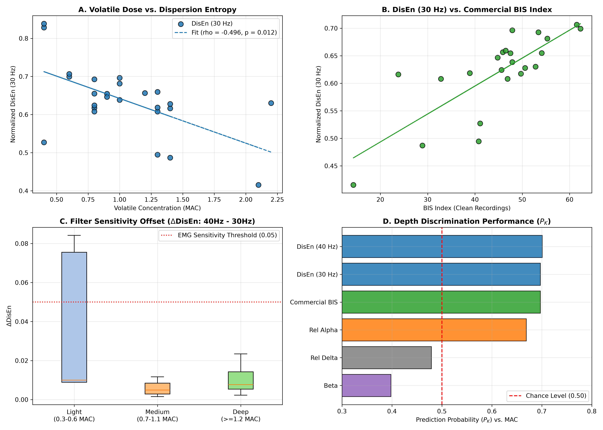

# Benchmarking Dispersion Entropy (DisEn) for Anesthetic Depth Monitoring

A reproducible neuroengineering pipeline benchmarking **Dispersion Entropy (DisEn)** against classical EEG metrics (relative band powers, aperiodic spectral exponent $\beta$) and commercial BIS indices across volatile anesthetic maintenance regimes using the open-access **VitalDB** clinical database.

---

## Key Results Summary ($N = 25$ Stratified Epochs)



* **Parity with Proprietary Standards:** DisEn ($0.5\text{--}30\text{ Hz}$) achieved a Prediction Probability of **$P_K = 0.697$** ($\rho = -0.496, p = 0.0117$), matching the commercial Bispectral Index (**$P_K = 0.697$**, $\rho = -0.479$) while operating via an open-source, non-linear mathematical framework with zero algorithmic smoothing delay.
* **Filter Cutoff Sensitivity ($30\text{ Hz}$ vs. $40\text{ Hz}$):** While a $40\text{ Hz}$ cutoff nominally elevated $P_K$ ($0.701$), it caused prominent complexity inflation ($\Delta\text{DisEn} > +0.08$) in epochs with sub-clinical facial electromyographic (EMG) tone. A strict $30\text{ Hz}$ low-pass boundary provides superior resilience against non-cortical artifacts.
* **Superiority over Classical Power Ratios:** DisEn significantly outperformed relative delta power ($P_K = 0.479$) and unparameterized spectral exponent $\beta$ ($P_K = 0.398$).

| Metric | Prediction Probability ($P_K$ vs. MAC) | Spearman $\rho$ | $p$-value | Clinical Notes |
| :--- | :---: | :---: | :---: | :--- |
| **DisEn (0.5–30 Hz)** | **0.697** | **-0.496** | **0.0117** | Robust against EMG; matches BIS |
| **DisEn (0.5–40 Hz)** | **0.701** | **-0.492** | **0.0124** | Vulnerable to high-frequency muscle artifact |
| **Commercial BIS (clean)** | **0.697** | **-0.479** | **0.0206** | Exhibited sensor lock-out artifacts ($0.0$) in $8\%$ of valid cases |
| **Relative Alpha (8–12 Hz)** | 0.669 | -0.469 | 0.0179 | Captures anteriorization; saturates at deep volatile levels |
| **Relative Delta (0.5–4 Hz)** | 0.479 | +0.080 | 0.7054 | Inadequate as an isolated depth predictor |
| **Spectral Exponent ($\beta$)** | 0.398 | +0.272 | 0.1885 | Sensitive to broadband fitting windows without FOOOF decomposition |

---

## Pipeline Architecture

1. **Cohort Discovery & Screening:** Automatically queries the VitalDB track catalog for cases containing simultaneous raw frontal EEG (`BIS/EEG1_WAV` at 128 Hz) and volatile anesthetic concentration (`Primus/MAC`).
2. **Steady-State Epoch Extraction:** Isolates periods of volatile stability ($\ge 5\text{ min}$, $\Delta\text{MAC} \le 0.05$) and extracts the central 20-second window.
3. **Clinical Artifact Rejection:**
   * Rejects voltage saturation and motion clipping: $\vert{}V(t)\vert{} \ge 100\ \mu\text{V}$.
   * Rejects burst suppression epochs: fraction of samples $<5\ \mu\text{V}$ must be $<5\%$.
   * Rejects incomplete epochs containing `NaN` intervals.
4. **Non-linear & Spectral Feature Extraction:**
   * **Dispersion Entropy:** Normal Cumulative Distribution Function (NCDF) mapping with embedding dimension $m=3$, class count $c=4$, and time lag $d=1$.
   * **Multitaper Spectral Estimation:** Discrete Prolate Spheroidal Sequences (DPSS, $NW=3, K=3$) for relative delta ($0.5\text{--}4\text{ Hz}$) and alpha ($8\text{--}12\text{ Hz}$).
   * **Aperiodic Exponent ($\beta$):** Robust log-log linear fit over $2\text{--}30\text{ Hz}$.

---

## Repository Structure

```text
├── data/
│   ├── cohort_features.csv        # Initial cohort extraction
│   └── stratified_cohort.csv      # N=25 stratified feature table
├── figures/
│   ├── final_project_benchmarks.png # Primary 4-panel diagnostic figure
│   └── cohort_benchmarks.png      # Exploratory multi-panel comparison
├── src/
│   ├── pipeline.py                # Discovery & quality control logic
│   ├── step2_features.py          # Single-epoch feature extraction benchmark
│   ├── step4_stratified_batch.py  # Stratified multi-case data ingestion
│   ├── step5_benchmark_stats.py   # Statistical scoring (P_K, Spearman rho)
│   └── generate_final_report.py   # High-resolution figure generation
├── requirements.txt
├── .gitignore
└── README.md
```

---

## Quickstart & Reproducibility

### 1. Clone Repository & Setup Environment
```bash
git clone [https://github.com/](https://github.com/)<your-username>/tum-eeg-disen.git
cd tum-eeg-disen
python -m venv venv
# On Windows PowerShell:
.\venv\Scripts\Activate.ps1
# On macOS/Linux:
source venv/bin/activate
pip install -r requirements.txt
```

### 2. Run Stratified Extraction & Feature Pipeline
```bash
python src/step4_stratified_batch.py
```

### 3. Compute Statistical Benchmarks ($P_K$, $\rho$)
```bash
python src/step5_benchmark_stats.py
```

### 4. Reproduce Figures
```bash
python src/generate_final_report.py
```