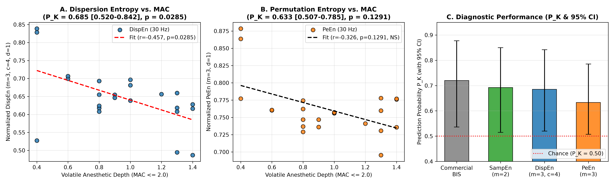
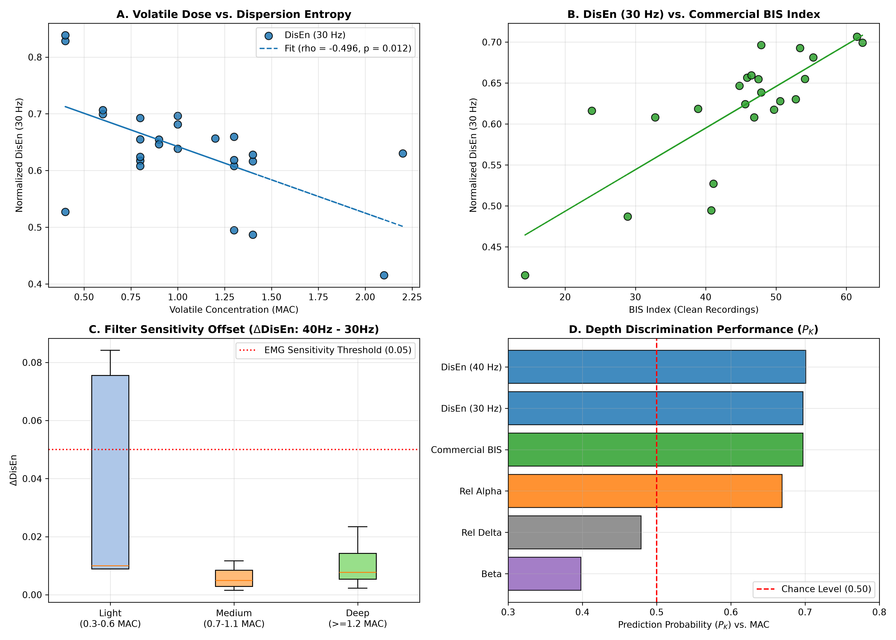

# Evaluating Normalized Dispersion Entropy for Intraoperative EEG Depth-of-Anesthesia Monitoring

[](https://www.python.org/)
[-success.svg)](https://vitaldb.net/)
[](https://www.tum.de/)

**Authors:** Vaibhav Purbia & Dr. Matthias Kreuzer  
**Institution:** Department of Anesthesiology and Intensive Care Medicine, Technical University of Munich (TUM) | Department of Electronics and Instrumentation Engineering, Rajasthan Technical University, Kota, India  

---

## 📌 Overview
Commercial depth-of-anesthesia (DoA monitors such as the **Bispectral Index (BIS)** correlate with volatile anesthetic concentration during surgical maintenance, but rely on proprietary algorithms that introduce multi-second smoothing delays and remain susceptible to high-frequency frontalis electromyographic (EMG) interference (`30-100 Hz`).

This repository contains an automated pharmacokinetic steady-state mining and signal processing pipeline across the **VitalDB surgical repository (`N = 5,800+` cases)**. It evaluates **Normalized Dispersion Entropy (`DispEn`)** against commercial BIS, **Sample Entropy (`SampEn`)**, **Permutation Entropy (`PeEn`)**, **95% Spectral Edge Frequency (`SEF95`)**, and **Multitaper spectral features** (`NW = 3.0, K = 3`) across steady-state volatile anesthesia maintenance plateaus (`MAC <= 2.0`).

---

## 🚀 Comprehensive Benchmark Results (`N = 23` Plateaus across `13` Patients, `MAC <= 2.0`)

All metrics were evaluated on `20 s` central artifact-free EEG epochs (`fs = 128 Hz`, `N = 2,560` samples) extracted from verified steady-state maintenance plateaus (`>= 5 min`, `delta MAC <= 0.05`, restricted to `MAC <= 2.0` to avoid burst suppression confounding). Confidence intervals (`95% CI`) for Smith's Prediction Probability (`P_K`) were derived via `1,000`-iteration bootstrap resampling.

| Metric (`0.5-30 Hz` Passband) | Smith's `P_K` vs. MAC `[95% CI]` | Spearman `r` (vs. MAC) | Spearman `r` (vs. BIS) | EMG Shift (`40Hz - 30Hz`) | Time Complexity / Latency (per 20s) |
| :--- | :---: | :---: | :---: | :---: | :---: |
| **Commercial BIS Monitor** | `0.720 [0.536-0.877]` | — | `1.000` (Reference) | Proprietary Filter | Multi-second smoothing lag |
| **Normalized DispEn (`m=3, c=4, d=1`)** | **`0.685 [0.520-0.842]`** | **`-0.457` (`p = 0.0285`)** | **`+0.769` (`p < 0.0001`)** | **`+0.0140`** | **`O(N)` / `0.124 ms`** |
| **Sample Entropy (`SampEn, m=2, r=0.2`)** | `0.692 [0.515-0.850]` | `-0.473` (`p = 0.0225`) | `+0.788` (`p < 0.0001`) | `+0.0699` | `O(N^2)` / `>1,000x slower` |
| **Permutation Entropy (`PeEn, m=3, d=1`)** | `0.633 [0.507-0.785]` | `-0.326` (`p = 0.1291`, NS) | `+0.026` (`p = 0.9110`, NS) | `+0.0312` | `O(N m log m)` / `0.166 ms` |
| **Spectral Edge Frequency (`SEF95, 30 Hz`)** | `0.636 [0.506-0.798]` | `-0.334` (`p = 0.1191`, NS) | `+0.644` (`p = 0.0016`) | `+1.1543 Hz` | `O(N log N)` / Fast FFT |
| **Aperiodic Spectral Exponent (`Beta`, OLS)** | `0.689 [0.526-0.830]` | `+0.500` (`p = 0.0152`) | `-0.337` (`p = 0.1351`, NS) | `+0.3328` | `O(K N log N)` / Multitaper |
| **Relative Alpha Power (`8-12 Hz`)** | `0.651 [0.513-0.799]` | `-0.423` (`p = 0.0445`) | `+0.700` (`p = 0.0004`) | — | `O(K N log N)` / Multitaper |
| **Relative Delta Power (`0.5-4 Hz`)** | `0.591 [0.505-0.732]` | `+0.044` (`p = 0.8430`, NS) | `-0.231` (`p = 0.3132`, NS) | — | `O(K N log N)` / Multitaper |

### Key Takeaways
1. **Comparable Performance to Commercial BIS with an Open Algorithm:** Under a strict `0.5-30 Hz` passband, `DispEn` achieves `P_K = 0.685 [0.520-0.842]`, tracking steady-state `MAC` (`r = -0.457, p = 0.0285`) and aligning strongly with commercial BIS (`r = +0.769, p < 0.0001`) in `0.124 ms` per `20 s` epoch.
2. **Why `DispEn` and `SampEn` Outperform `PeEn` and `SEF95`:** At `fs = 128 Hz` with a `30 Hz` low-pass filter, a 3-sample window (`15.6 ms`) is shorter than the minimum half-cycle of a `30 Hz` oscillation (`16.7 ms`), causing local windows to become predominantly rising or falling. Because `PeEn` discards metric amplitude, it fails to reach statistical significance across maintenance steps (`p = 0.1291`). Both `DispEn` (via `c=4` NCDF amplitude quartiles) and `SampEn` (via `r = 0.2*sigma` tolerance) preserve amplitude scaling and resolve concentration changes reliably.
3. **Computational Speed & EMG Resilience (`DispEn` vs. `SampEn`):** While `SampEn` and `DispEn` provide nearly identical diagnostic accuracy (`delta P_K = 0.007`), `SampEn` incurs an `O(N^2)` quadratic cost and suffers **5.0x higher EMG inflation** (`+0.0699` vs. `+0.0140`) when widening the passband from `30 Hz` to `40 Hz`.

---

## 📊 Visual Benchmarks

### Comparative Performance Across Steady-State Maintenance (`MAC <= 2.0, N = 23`)


### Baseline Spectral & Filter Sensitivity Diagnostics


---

## 📂 Repository Structure & Reproducible EEG Dataset

All `23` raw `20 s` EEG episodes (`.npy` waveform arrays at `128 Hz`), patient `caseid` mappings, `MAC` concentrations, and commercial `BIS` reference values are archived in `data/raw_reproducible_epochs/` for full offline reproducibility:

```text
tum-eeg-disen/
├── data/
│   ├── raw_reproducible_epochs/               # 23 raw 20s EEG waveform arrays (.npy) + manifest.csv
│   ├── stratified_cohort_fully_enriched.csv   # Full N=23 (MAC<=2.0) benchmark table across all metrics
│   ├── stratified_cohort.csv                  # Initial extracted plateau metadata
│   └── cohort_features.csv                    # Pilot feature table
├── figures/
│   ├── disen_vs_pe_comparison.png             # Main 3-panel comparative figure (DispEn, PeEn, SampEn, BIS)
│   ├── final_project_benchmarks.png           # Spectral & 30Hz vs. 40Hz filter sensitivity figure
│   ├── cohort_benchmarks.png                  # Cohort correlation plots
│   └── case1_feature_benchmark.png            # Single-epoch time series & Multitaper PSD diagnostic
├── src/
│   ├── pipeline.py                            # VitalDB track ingestion & plateau detection
│   ├── step2_features.py                      # NCDF Dispersion Entropy & DPSS Multitaper PSD (NW=3, K=3)
│   ├── step3_plot_cohort.py                   # Cohort visualization routines
│   ├── step4_stratified_batch.py              # Automated stratified cohort mining across VitalDB
│   ├── step5_benchmark_stats.py               # Smith's P_K and Spearman rank correlation analysis
│   └── generate_final_report.py               # Multi-panel report figure generator
├── benchmark_disen_vs_pe.py                   # VitalDB extraction & reproducible epoch export script
├── update_stats_and_figures.py                # Fast offline statistical evaluation & figure generator
├── find_tracks.py                             # VitalDB track discovery utility
└── requirements.txt                           # Python package dependencies